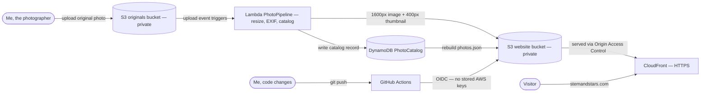

# Stem and Stars — Serverless Photography Portfolio with an Automated Image Pipeline

**Live:** https://stemandstars.com

## What this is
My photography portfolio, built as a real serverless system on AWS. The site updates itself: I upload a full-quality photo to a storage bucket, and within seconds a resized web image, a thumbnail, and a catalog entry appear — the gallery page rebuilds its own index and displays the new photo. No manual website edits per photo.

## Architecture

- **Amazon S3 (two buckets)** — a private "originals" bucket for full-quality uploads, and a private website bucket holding the page, resized images, thumbnails, and a generated `photos.json` index.
- **Amazon CloudFront** — serves the site over HTTPS from the private website bucket using Origin Access Control (the bucket is never public). Custom domain via **Route 53**, certificate from **AWS Certificate Manager** (apex + wildcard).
- **AWS Lambda (Python 3.12, Pillow layer)** — triggered by every upload to the originals bucket. Applies EXIF orientation, extracts camera model and date taken, generates a 1600px web image and a 400px thumbnail, writes a catalog record, then rebuilds `photos.json` from the catalog.
- **Amazon DynamoDB (on-demand)** — `PhotoCatalog` table, partition key `photoId` (the file name, so re-uploading a photo updates its record instead of duplicating it).
- **IAM** — the function runs on a least-privilege execution role: read originals, write web assets, and work with only its own table.

## Repo layout
- `/site` — the web page (`index.html`). The gallery is data-driven: it fetches `photos.json` and builds itself.
- `/lambda` — the `PhotoPipeline` function code.
- `/terraform` — the Phase 3 rebuild of this same stack as infrastructure as code.

## Design decisions worth noting
- **The catalog is the single source of truth.** The page renders whatever `photos.json` says; the manifest is rebuilt from DynamoDB after every processed upload.
- **Titles come from file names** (hyphens/underscores become spaces), so naming a file well before upload is the whole content workflow.
- **Delete handling is deliberately simple:** removing a photo means deleting its catalog item; the next upload rebuilds the index. A delete-event trigger is a known future improvement.
- **Cost:** roughly $1.43/month — breakdown below.

## Monthly cost

| Item | Cost |
|---|---|
| Domain — stemandstars.com (Route 53) | ~$16/year (≈ $1.33/month) |
| S3 — storage and requests for both buckets | under $0.10/month |
| CloudFront — delivery | pennies; this traffic sits inside the free tier |
| Lambda + DynamoDB | $0.00 at this scale (free tier) |
| **Total** | **≈ $1.43/month** |

## What broke, and what I learned (Oct 31, 2026 debugging session)
- **The function failed at startup with `KeyError: 'TABLE_NAME'`** — I had typed the environment variable as `Table_NAME`. AWS names are case-sensitive everywhere; the fix was one character.
- **DynamoDB then rejected every write:** the table's partition key had been created as `photoID` while the code writes `photoId`. A key schema can't be edited after creation, so the table was recreated — painless while it was still empty.
- **Method that worked:** read the CloudWatch logs first, fix the exact named cause, re-upload to re-trigger (S3 does not replay past upload events).

## What broke, and what I learned (Nov 1 2026 - CI/CD incidents)
- **GitHub Actions couldn't assume the deploy role.** The OIDC trust policy expected GitHub's old subject format, but CloudTrail showed the actual `sub` claim had changed to embed numeric IDs (`repo:bmanzke@214350599/aws-photography-portfolio@1440835875:*`). Lesson: when auth fails, read the real claim from the audit log instead of guessing at the policy — then pin the trust condition to what the token actually says.
- **My first successful deploy deleted every generated image and thumbnail.** The workflow used `aws s3 sync --delete`, which mirrors the source folder exactly — and the Lambda-generated files aren't in the local folder, so sync treated them as deletions. Originals were never at risk (separate bucket, by design). I recovered by re-copying the originals to re-trigger the pipeline and invalidating CloudFront, then hardened the workflow to deploy only `index.html` via `s3 cp`. Lesson: a deploy step should never carry a delete flag near assets another system generates.
## Status
- **Phase 1** (site, domain, HTTPS) — complete Oct 24, 2026.
- **Phase 2** (automated pipeline + catalog) — complete Oct 31, 2026.
- **Phase 3** (Terraform rebuild + GitHub Actions CI/CD with OIDC) — complete Nov 1, 2026. The live site runs entirely on the Terraform-managed stack.
- **Design phase** — complete Nov 6, 2026: hand-written HTML/CSS/JavaScript front end (rotating hero, data-driven gallery with title/date captions, lightbox), still rendered from the same `photos.json` contract. 15 photos live.
- **Next:** a Manz Made portfolio site for a real client on the same pattern, then an AWS-native contact form (API Gateway + Lambda + SES) as Project 1.5.